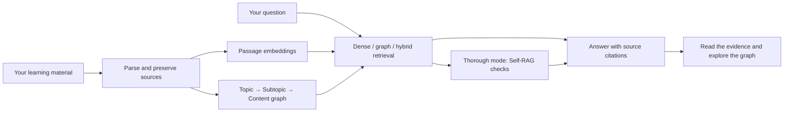

<p align="center">
  
</p>

<h1 align="center">LuminRAG</h1>

<p align="center"><strong>Turn your learning material into answers you can trace.</strong></p>
<p align="center">Source-grounded questions. An editable concept graph. Your own AI provider.</p>

<p align="center">
  <a href="LICENSE"></a>
  <a href="docs/getting-started.md"></a>
  <a href="frontend/package.json"></a>
  <a href="docs/usage.md"></a>
</p>

<p align="center">
  <a href="#quick-start">Quick start</a> ·
  <a href="docs/usage.md">User guide</a> ·
  <a href="docs/deployment.md">Deploy</a> ·
  <a href="code_logic.md">Architecture</a> ·
  <a href="CONTRIBUTING.md">Contribute</a>
</p>

LuminRAG is an educational question-answering app that connects your documents through a **Topic → Subtopic → Content** knowledge graph. Ask a question, inspect the supporting passages, and explore the concepts used to answer it. Dense retrieval, graph retrieval and Self-RAG verification make the evidence visible as you learn.

## What you can do

| Capability | How it helps |
| --- | --- |
| **Ask with evidence** | Open numbered citations at the supporting PDF page, slide or extracted passage. |
| **Explore connected concepts** | Follow highlighted graph paths and inspect source-backed connections. |
| **Build your own notes** | Edit concepts, add Markdown and LaTeX notes, create `[[wikilinks]]`, merge duplicates, and undo changes. |
| **Choose your retrieval** | Use dense, graph or hybrid retrieval; choose Fast or Thorough reasoning. |
| **Bring your material** | Import PDFs, images, Office files, HTML, EPUB, Markdown and text. Self-hosted audio/video is optional. |
| **Keep portable knowledge bases** | Store files, graphs and chats in your browser; export `.lumin` backups to move between devices. |
| **Choose your AI provider** | Connect OpenAI, OpenRouter or Anthropic with your own key. Search the OpenRouter model catalog or enter a model ID. Self-hosting also supports Ollama. |

## How it works



The frontend uses React, TypeScript, Sigma and IndexedDB. The Python service uses FastAPI, FastEmbed, NumPy and NetworkX. See the [architecture](code_logic.md) and [API reference](docs/reference.md) for details.

## Quick start

For a public Docker deployment, copy `.env.example` to `.env`, set your hostname
and the token of a dedicated Cloudflare Tunnel, then run
`docker compose up -d --build --wait --wait-timeout 300`.
The [deployment guide](docs/deployment.md) covers the one-time dashboard route.
Docker supplies Python and Node; host installations are not required.

Requires **Python 3.12+**, **Node.js 22+** and **pnpm 10**. Run from the repository root in PowerShell:

```powershell
git clone https://github.com/karaberke/luminrag.git
cd luminrag
python -m venv .venv
.venv/Scripts/python.exe -m pip --isolated install --index-url https://pypi.org/simple --require-hashes --only-binary=:all: -r requirements-bootstrap.lock
.venv/Scripts/python.exe -m pip --isolated install --index-url https://pypi.org/simple --require-hashes --only-binary=:all: -r requirements-hosted.lock
.venv/Scripts/python.exe -m pip check
pnpm --dir frontend install --frozen-lockfile
.\scripts\run_local.ps1
```

Open **http://127.0.0.1:5173**, connect a provider in **AI settings**, and upload your first document. Initial startup downloads and verifies the pinned retrieval models. Your provider charges apply when you process material or ask questions.

The launcher starts both services in temporary-workspace mode. Use `-SelfHosted` for persistent local storage. For separate terminals, macOS/Linux setup, optional audio/video, or Docker, see [getting started](docs/getting-started.md).

## Your data and keys

- **Browser storage:** Knowledge bases, original files and chats live in IndexedDB. Export backups before clearing browser data.
- **Temporary hosted compute:** The service parses material, builds embeddings and runs retrieval in isolated temporary workspaces. It can restore compute state from your browser when its cache expires.
- **Your provider:** Prompts and relevant source context go to the AI provider you select. Use HTTPS for remote deployments.
- **Key handling:** Provider keys are held in the current tab's memory and temporarily in server memory while processing requests. They are sent over HTTPS and never written to browser storage, server storage, logs or workspace backups. Closing the tab clears its copy.
- **Local files:** Actual `.env` files, credential files, local datasets and agent instructions are excluded from Git. The committed `.env.example` templates contain no keys.

Read the [security policy](SECURITY.md) and [deployment guide](docs/deployment.md) before exposing a service publicly.

## Documentation

| I want to… | Start here |
| --- | --- |
| Run locally or with Docker | [Getting started](docs/getting-started.md) |
| Upload, ask questions, edit graphs or restore a backup | [User guide](docs/usage.md) |
| Deploy the frontend and Python service | [Deployment guide](docs/deployment.md) |
| Configure limits or call the API | [Configuration and API](docs/reference.md) |
| Understand the data and reasoning pipeline | [Architecture](code_logic.md) |
| Run checks or contribute a change | [Contributing](CONTRIBUTING.md) |

## Current boundaries

Standard PDF ingestion requires selectable text; scanned pages need the visual slide option with a vision-capable provider or external OCR. Hosted audio/video is not supported. Word previews can paginate differently from Microsoft Word. Browser storage can be cleared or evicted, so keep exported backups. Application login and optional Drive sync are future work.

## License

Created and maintained by [Berke Kara](https://github.com/karaberke). Licensed under [AGPL-3.0](LICENSE). Operators of modified network-accessible versions must provide the corresponding source as required by the license.
